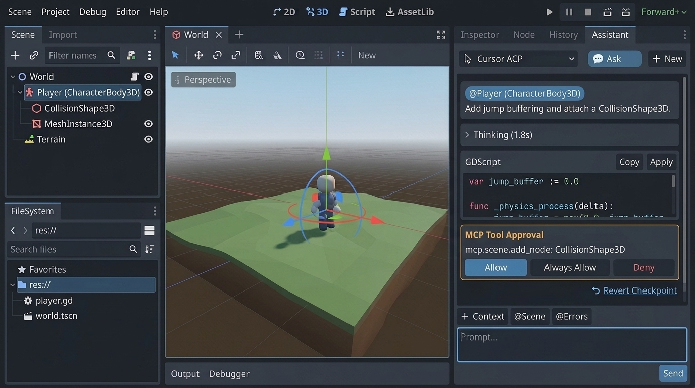
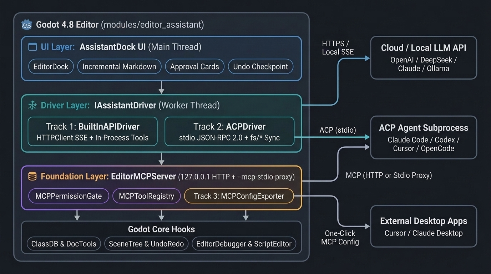
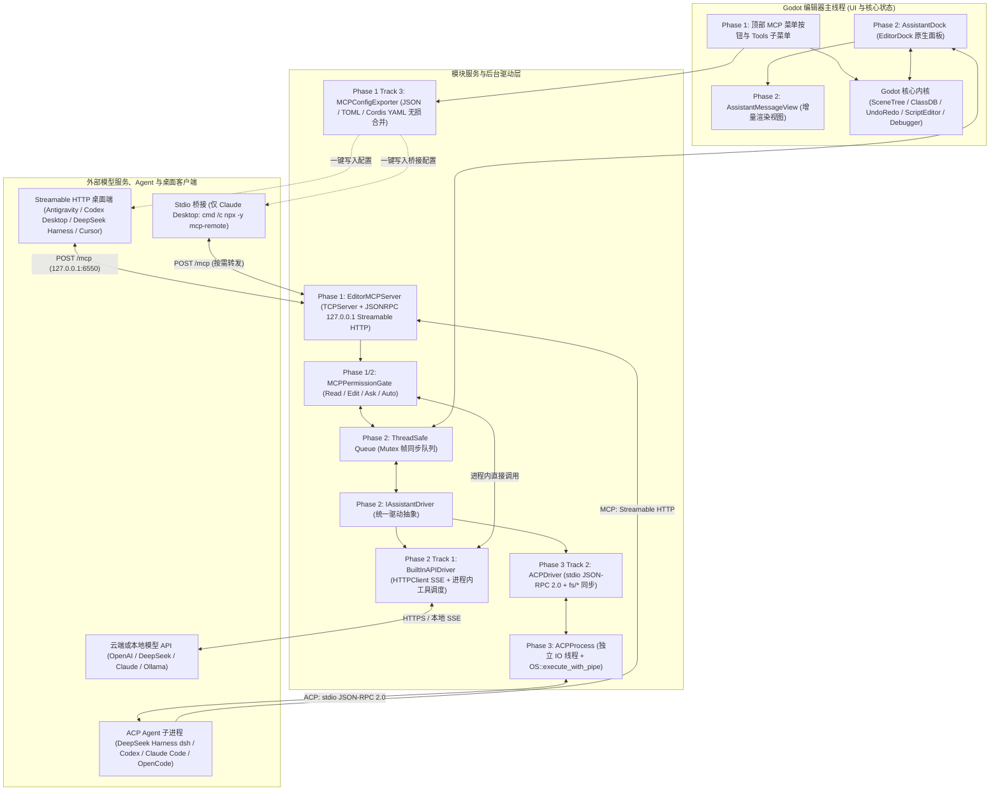
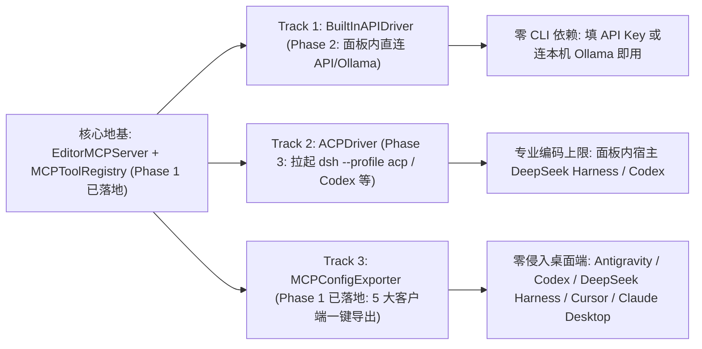
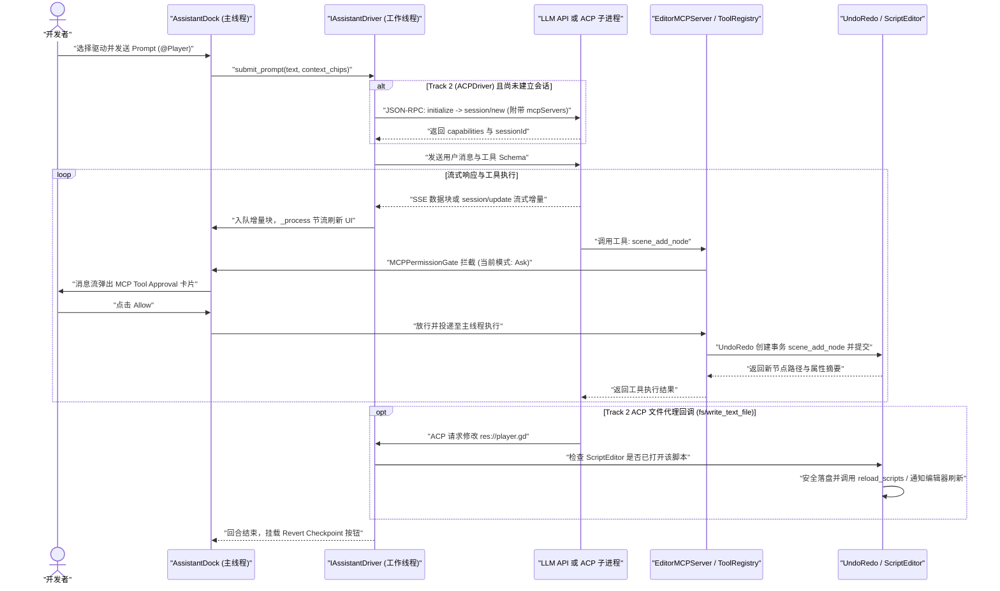
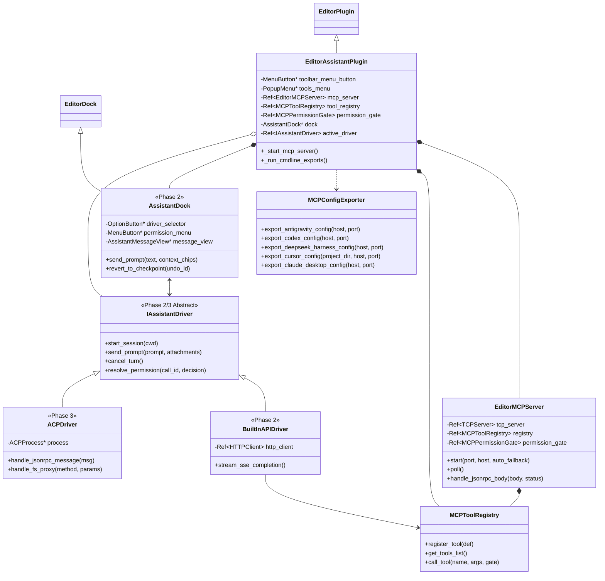

# Godot 4.8 原生 AI 协作面板（`modules/editor_assistant`）架构设计文档（已同步 Phase 1 落地版）

> [!NOTE]
> 本文档面向用户在 [version.py](../../version.py) 所在的 Godot `4.8`（beta）源码分支上的定制开发规划，借鉴 Unreal Engine 5.9 的实战架构，采用 **“一核三路”** 设计：以同一套纯内置 `EditorMCPServer` 为地基，同时打通 **内置 API 直连（开箱即用）**、**ACP 外部 Agent 宿主（拉高上限）** 与 **外部桌面端一键接入（零配置协作）** 三条通路。Phase 1 底座与多端配置导出已于提交 `4a10783578` / `07907dc588` 落地。

---

## 1. 设计背景与核心原则

UE 5.9 之所以能兼顾“新手零门槛体验”与“重度开发者复用强力编码 Agent”，关键在于它没有将底座与单一后端绑定，而是以统一的 `Unreal MCP` 为核心，同时提供官方内置助手、ACP 外部 Agent 以及 `ModelContextProtocol.GenerateClientConfig` 外部客户端配置导出三条通路。

将这套理念落入 Godot 4.8，在保持开源轻量基因的前提下，本模块遵循以下四项核心原则：

1. **引擎原有源码零侵入（零导出膨胀）**：全部代码严格隔离在 `modules/editor_assistant/`，不修改 `main/main.cpp` 或任何引擎现有核心文件；仅在 `env.editor_build` / `TOOLS_ENABLED`（编辑器构建）条件下编译，导出游戏模板（Export Templates）编译跳过该模块，同步上游 Godot `git rebase` 冲突风险最低。
2. **一核三路，统一驱动接口**：UI 层只面对抽象接口 `IAssistantDriver`；后端平级挂载 `BuiltInAPIDriver`（免 CLI 开箱即用）与 `ACPDriver`（接入外部专业编码 Agent），并由 `MCPConfigExporter` 服务外部桌面端，统一复用同一套 `MCPToolRegistry`。
3. **单二进制纯 HTTP MCP 闭环**：复用 Godot 内置 `JSONRPC`（[jsonrpc.h](../../modules/jsonrpc/jsonrpc.h#L37)）、`TCPServer`（[tcp_server.h](../../core/io/tcp_server.h#L37)）、`HTTPClient`（[http_client.h](../../core/io/http_client.h#L37)）与 `OS::execute_with_pipe`（[os.h](../../core/os/os.h#L220)）。编辑器内原生运行 Streamable HTTP MCP 服务端（`127.0.0.1:<port>/mcp`），避免修改主程序 `stdio` 引发日志串流或 Windows 下重新编译 `.exe` 被桌面端锁文件（`LNK1104`）。
4. **编辑器安全优先**：所有节点树与资源修改强制经过 `EditorUndoRedoManager` 事务栈；后续脚本读写优先同步内置 `ScriptEditor` 内存缓冲区；敏感工具受内置权限闸门（`Read` / `Edit` / `Ask` / `Auto`）约束。

---

## 2. 原生面板交互原型（`AssistantDock` UI）



### 2.1 停靠与多窗口集成（Phase 2 目标）

`AssistantDock` 继承自 [editor_dock.h](../../editor/docks/editor_dock.h#L40) 中的 `EditorDock`，在模块初始化时通过 `EditorPlugin::add_dock`（见 [editor_plugin.h](../../editor/plugins/editor_plugin.h#L169)）注册：

* **默认停靠槽位**：`EditorDock::DOCK_SLOT_RIGHT_UL`（右侧上栏，与 [inspector_dock.cpp](../../editor/docks/inspector_dock.cpp#L752) 的 `InspectorDock`、`Node`、`History` 并列标签页）。
* **自由布局支持**：保留 `DOCK_LAYOUT_VERTICAL | DOCK_LAYOUT_FLOATING`，支持一键弹出为独立悬浮窗口拖拽至副屏，并自动持久化布局配置。
* **Phase 1 现状入口**：在 `AssistantDock` 落地前，已在编辑器顶部工具栏挂载状态菜单按钮 **`MCP :<port>`**（`CONTAINER_TOOLBAR`）与 **`Project -> Tools -> AI Assistant (MCP)`** 子菜单，用于查看运行状态与一键配置外部客户端。

### 2.2 五大 UI 功能区拆解（Phase 2/3）

| 区域 | 对应 Godot 原生控件 | 核心职责 |
| :--- | :--- | :--- |
| **顶部控制栏** | `OptionButton` + `MenuButton` + `Button` | 切换驱动模式与预设（`Built-in API` / `Ollama` / `DeepSeek Harness ACP` / `Codex ACP` / `Claude Code ACP` / `Cursor ACP`）；切换权限级别（`Read` / `Edit` / `Ask` / `Auto`）；触发导出 MCP 配置与新建会话。 |
| **增量流式消息流** | `ScrollContainer` + `RichTextLabel` + `CodeEdit` + `FoldableContainer` | 统一渲染来自 `BuiltInAPIDriver` 或 `ACPDriver` 的增量消息：普通 Markdown 转 BBCode 写入 `RichTextLabel`；代码块嵌入只读 `CodeEdit` 并挂载 [syntax_highlighters.h](../../editor/script/syntax_highlighters.h) 高亮器（附 `Copy` / `Apply` 按钮）；Thinking 思维链与工具日志收入 `FoldableContainer`。 |
| **内联审批卡片** | `PanelContainer` + `HBoxContainer` | 当权限模式为 `Ask` 且调用写操作或运行时操作时，消息流内就地暂停并弹出 `MCP Tool Approval` 卡片，提供 `Allow`、`Always Allow`、`Deny` 按钮。 |
| **对话级时光机** | `Button`（绑定 Undo 历史版本 ID） | 每轮对话开始前记录一次 `EditorUndoRedoManager` 快照点；消息卡片下方提供 `Revert Checkpoint`，一键回滚该轮引发的全部场景与资源改动。 |
| **上下文输入栏** | 自定义 `TextEdit` + Tag Chip 容器 | 支持直接从 `SceneTreeDock` 拖入节点、从 `FileSystemDock` 拖入 `.gd`/`.tscn`/`.tres`，或点击 `+ Context` / `@Scene` / `@Errors` 快速注入当前报错堆栈与选中节点状态。 |

> [!TIP]
> **流式渲染防卡顿策略**：后台吐出流式增量时，不重复全量重排历史消息。`AssistantMessageView` 只对**最后一个尚未闭合的活跃块**做增量更新；一旦代码块或段落结束标记到达，即冻结该节点控件并新建下一个活跃块。

---

## 3. 系统总体架构与线程边界



### 3.1 分层架构与线程隔离模型

为了保证网络 SSE 流读取、子进程管道通信与本地 HTTP 监听不阻塞 Godot 编辑器的 UI 渲染帧率，模块严格划分了**主线程**、**工作线程**与**进程外边界**：



### 3.2 纯内置 Streamable HTTP 方案（方案 3：零主干修改与双模式接入）

在 Phase 1 细化设计阶段，我们对比了“改动 `main/main.cpp` 为主程序新增独立 `stdio` 转发模式”与“纯内置 Streamable HTTP 服务（对标 UE 5.9 `Unreal MCP`）”两种路线，最终确定并落地后者（**方案 3**）：

1. **避免 `main/main.cpp` 改动与 Windows `.exe` 锁冲突**：
   * 不改造 `main.cpp` 与编辑器标准输出流，消除引擎启动横幅/日志污染 JSON-RPC `stdout` 的隐患；
   * 外部桌面端不再直接拉起编辑器 `.exe` 作为长驻 `stdio` 子进程，避免日常 SCons 重编编辑器时因 `.exe` 被桌面端占锁而触发 `LNK1104`。
2. **原生 Streamable HTTP 直连（推荐客户端主力路径）**：
   * `EditorMCPServer` 默认在 `127.0.0.1:6550`（端口冲突时支持按 `auto_fallback_port` 自动顺延 `6550..6560`，或通过 `OS::get_singleton()->get_cmdline_user_args()` 解析 `-- --mcp-port <port>`）提供 `/mcp`（兼容尾斜杠 `/mcp/`）、`/` 与 `/health`；
   * **Antigravity**、**Codex Desktop / CLI**、**DeepSeek Harness (`@deepseek-ai/dsh-mcp-client`)**、**Cursor** 均支持原生 Streamable HTTP，直接配置 `"http://127.0.0.1:<port>/mcp"` 即可通信，协商兼容 `2024-11-05`、`2025-03-26`、`2025-06-18`、`2025-11-25` 四个 MCP 规范版本。
3. **仅认 `stdio` 的客户端兼容方案**：
   * 对仅认 `stdio` 的旧客户端（如 Claude Desktop），通过标准开源 `mcp-remote`（Windows 下自动包裹 `cmd /c npx -y mcp-remote <url>`）按需桥接；后续 Phase 3 若遇到不支持 `mcpCapabilities.http` 的 ACP 子进程，同样可按需注入轻量 HTTP 桥接而不触动引擎主入口。

---

## 4. 对标 UE 5.9 的“一核三路”选型设计



### 三条通路与 UE 5.9 对比表

| 通路 | UE 5.9 对应方案 | Godot `modules/editor_assistant` 实现 | 当前状态与核心价值 |
| :--- | :--- | :--- | :--- |
| **Track 1：内置直连驱动** | `Unreal Assistant` 连 Epic 云服务 | `BuiltInAPIDriver`（基于 `HTTPClient` SSE + 进程内 Function Calling，支持 OpenAI 兼容格式 / DeepSeek / Anthropic / 本机 Ollama & LM Studio） | **Phase 2 规划**：不装外部 CLI 即可直接在右侧面板聊天并调用本地 15+ 引擎工具。 |
| **Track 2：ACP 外部 Agent 宿主** | `External Agent`（ACP 拉起外部编码 Agent） | `ACPDriver` + `ACPProcess`（基于 `OS::execute_with_pipe` 走 `stdio` JSON-RPC 2.0，优先适配本机已有 **DeepSeek Harness `dsh --profile acp`** 与 **Codex**，兼容 Claude Code / Cursor / OpenCode） | **Phase 3 规划**：在 Godot 界面内部驱动强力编码 Agent 并同步 `fs/*` 缓冲区与运行调试闭环。 |
| **Track 3：外部桌面端一键接入** | `ModelContextProtocol.GenerateClientConfig` 等命令 | `MCPConfigExporter` + 顶部 `MCP :<port>` 按钮 + `-- --mcp-export` CLI（已支持 **Antigravity** / **Codex Desktop** / **DeepSeek Harness** / **Cursor** / **Claude Desktop**） | **Phase 1 已落地**：不离开现有的 Antigravity / Codex 桌面版 / DeepSeek Harness 即可直连操纵 Godot 4.8。 |

---

## 5. 端到端协议交互时序与编辑器防冲突机制

无论前端选择 `BuiltInAPIDriver` 还是 `ACPDriver`，UI 渲染、工具权限审批（`Ask`）、`EditorUndoRedoManager` 事务提交与脚本缓冲区防冲突均走同一条闭环：



### 关键防冲突机制：脚本缓冲区协同（Phase 2/3）

在带有内置代码编辑器的游戏引擎中，外部工具直接写磁盘文件常会导致“用户未保存的编辑被覆盖”或“用户随后按 `Ctrl+S` 把 Agent 刚改好的代码冲掉”。

* **Track 1（`BuiltInAPIDriver`）与内部 `script_*` 工具**：直接在主线程读写 [script_editor_plugin.h](../../editor/script/script_editor_plugin.h#L505) 管理的打开缓冲区状态，先检查 `ScriptEditor::get_unsaved_files()`（见 [script_editor_plugin.h](../../editor/script/script_editor_plugin.h#L557)），落盘后触发 `ScriptEditor::reload_scripts(true)` / `notify_script_changed(...)`。
* **Track 2（`ACPDriver`）**：在 ACP `initialize` 阶段声明支持 `fs.readTextFile` / `fs.writeTextFile`，使外部 ACP 子进程的文本读写同样经过编辑器主线程仲裁，避免内存与磁盘状态撕裂。

---

## 6. 模块目录规划与核心 C++ 类设计

### 6.1 目录结构（`modules/editor_assistant/`）

```text
modules/editor_assistant/
├── config.py                         # [Phase 1 已落地] 仅 env.editor_build 启用；依赖 jsonrpc
├── SCsub                             # [Phase 1 已落地] 仅编入编辑器构建与可选 tests/*.cpp
├── register_types.h / .cpp           # [Phase 1 已落地] MODULE_INITIALIZATION_LEVEL_EDITOR 注册 EditorAssistantPlugin
├── editor_assistant_plugin.h / .cpp  # [Phase 1 已落地] 顶部 MCP 状态按钮 + Tools 子菜单 + EditorSettings + CLI 导出 + 服务启停轮询；[Phase 2] 挂载 AssistantDock
│
├── mcp/                              # 【统一地基：内置 Godot MCP Server，Phase 1 已落地核心】
│   ├── mcp_server.h / .cpp           # [Phase 1 已落地] 非阻塞 TCPServer + JSONRPC 2.0 Streamable HTTP 服务端 (/mcp, /mcp/, /health)
│   ├── mcp_config_exporter.h / .cpp  # [Phase 1 已落地] 无损合并导出：Antigravity (JSON) / Codex (TOML) / DeepSeek Harness (Cordis YAML) / Cursor / Claude Desktop
│   ├── mcp_permission_gate.h / .cpp  # [Phase 1 已落地] 分级审批策略 (Read / Edit / Ask / Auto)；[Phase 2] 挂起与回调
│   ├── mcp_tool_registry.h / .cpp    # [Phase 1 已落地] 工具 Schema 注册、权限检查与标准 CallToolResult 封装
│   └── tools/
│       ├── mcp_doc_tools.h / .cpp    # [Phase 1 已落地] 5 个只读工具：ClassDB + DocTools 查询与 res:// 本地文档检索读取
│       ├── mcp_scene_tools.h / .cpp  # [Phase 1 已落地] 10 个场景工具：全量经 EditorUndoRedoManager 提交场景树/节点/信号/资源修改
│       ├── mcp_script_tools.h / .cpp # [Phase 2] 基于 GDScriptWorkspace 的符号解析、语法诊断与缓冲区读写
│       └── mcp_runtime_tools.h / .cpp# [Phase 3] 基于 EditorRunBar + EditorDebuggerNode 的运行控制、报错抓取与截图
│
├── tests/
│   └── test_editor_assistant_mcp.h   # [Phase 1 已落地] doctest 用例：回环校验、MCP RPC、doc 沙箱、JSON/TOML/YAML 合并
│
├── driver/                           # 【Phase 2/3 规划：双驱动抽象层】
│   ├── assistant_driver.h            # IAssistantDriver 统一接口：start / send_prompt / cancel / resolve_permission
│   ├── builtin_api_driver.h / .cpp   # Track 1：基于 HTTPClient 的流式 SSE 解析与进程内 Function Calling 循环
│   ├── acp_process.h / .cpp          # 封装 OS::execute_with_pipe、独立读写线程、Windows .cmd 解析与进程树回收
│   └── acp_driver.h / .cpp           # Track 2：ACP JSON-RPC 2.0 协议栈、Preset 启动器与 fs/* 缓冲代理
│
└── ui/                               # 【Phase 2 规划：原生 EditorDock UI】
    ├── assistant_dock.h / .cpp       # 继承 EditorDock：驱动/预设切换、拖拽上下文接收、配置导出与审批交互
    └── assistant_message_view.h/.cpp # 增量 Markdown/BBCode/CodeEdit 渲染管线与 Checkpoint 回滚锚点
```

### 6.2 核心类关系图



---

## 7. 内置 Godot MCP 核心工具集（`MCPToolRegistry`）清单

遵循 OpenAI / Anthropic / Cursor 等客户端对工具名的正则要求（`^[a-zA-Z0-9_-]{1,64}$`，不可包含 `.`），全部注册工具统一采用**下划线命名**：

| 工具域 | 状态 | 注册工具名 | 底层引擎依赖与文件锚点 | 默认权限等级 | 核心解决的痛点 |
| :--- | :---: | :--- | :--- | :---: | :--- |
| **`doc_*`** | Phase 1 已落地 (5 个) | `doc_search_classes` / `doc_get_class_detail` / `doc_check_api` / `doc_search_project_docs` / `doc_read_project_doc` | `ClassDB` + `EditorHelp::get_doc_data()`（[doc_tools.h](../../editor/doc/doc_tools.h#L38)）+ `res://` Markdown 沙箱检索 | `Read` | 查询二进制内置 Godot 4.8 类文档、方法签名与废弃状态消除 API 幻觉；同时支持未挂载目录的桌面端安全读取项目 `res://` 下 `.md`/`.txt` 策划与规范文档。 |
| **`scene_*`** | Phase 1 已落地 (10 个) | `scene_get_tree` / `scene_create_root` / `scene_add_node` / `scene_remove_node` / `scene_reparent_node` / `scene_get_properties` / `scene_set_property` / `scene_connect_signal` / `scene_edit_resource` / `scene_save` | `EditorNode`（[editor_node.h](../../editor/editor_node.h#L125)）+ `EditorUndoRedoManager`（[editor_undo_redo_manager.h](../../editor/editor_undo_redo_manager.h)） | `scene_get_*` 为 `Read`；其余为 `Edit` | 在内存态 `SceneTree` 安全操作节点与 `.tres`，内置强类型 `JSON -> Variant` 转换，避免直接文本编辑 `.tscn` 破坏 `uid://` 拓扑，全量支持 `Ctrl+Z` 一步撤回。 |
| **`script_*`** | Phase 2 规划 | `script_get_diagnostics` / `script_get_open_buffer` / `script_apply_edit` | `GDScriptWorkspace`（[gdscript_workspace.h](../../modules/gdscript/language_server/gdscript_workspace.h)）+ `ScriptEditor`（[script_editor_plugin.h](../../editor/script/script_editor_plugin.h#L505)） | `Read` / `Edit` | 复用 GDScript LSP 现成的静态类型检查与错误诊断；读写操作直接同步编辑器标签页，防止覆盖未保存修改。 |
| **`runtime_*`** | Phase 3 规划 | `runtime_play_scene` / `runtime_stop` / `runtime_get_errors` / `runtime_inspect_remote_tree` / `runtime_capture_screenshot` | `EditorRunBar`（[editor_run_bar.h](../../editor/run/editor_run_bar.h#L45)）+ `EditorDebuggerNode`（[editor_debugger_node.h](../../editor/debugger/editor_debugger_node.h#L47)） | `Ask` | 打通“写代码 -> 一键运行 -> 抓运行报错堆栈/远程节点属性 -> 截游戏窗口视图回传多模态模型”的自动验证闭环。 |
| **`viewport_*`** | Phase 3 规划 | `viewport_get_selection_snapshot` | `SceneTreeDock`（[scene_tree_dock.h](../../editor/docks/scene_tree_dock.h#L53)）+ 2D/3D `SubViewport` | `Read` | 截取当前编辑视口画面并附带选中节点的 `Transform3D` / `Rect2` 空间坐标。 |

---

## 8. 关键工程避坑指南与三阶段演进路线

### 8.1 Windows 与跨平台工程避坑清单

1. **`EditorLog` 过滤与控制台输出可见性（Phase 1 已踩坑修复）**：用户关闭 `EditorLog::MSG_TYPE_EDITOR`（`_editor_log_filter_4 = false`）时，直接调用 `add_message(..., MSG_TYPE_EDITOR)` 会导致提示被屏蔽；插件状态提示统一走 `print_line(...)` 路由为 `MSG_TYPE_STD` 并同步至 `.console.exe`。
2. **Windows TOML 与 Cordis YAML 写入规范（Phase 1 已踩坑适配）**：
   * Codex `config.toml` 大量包含以反斜杠结尾的单引号字面量路径（如 `'\\?\C:\Users\...'`）与跨行 `args = [...]` 数组，合并修改必须带状态机解析字面量引号与括号深度，不可使用粗暴行替换。
   * DeepSeek Harness `cordis.patch.yml` 在 Windows 上若写入 UTF-8 BOM 会干扰 YAML 解析，导出时必须写无 BOM UTF-8，且妥善处理 `# 注释 + []` 占位文件以及同 `- insert:` 块下的兄弟插件条目（如已有 `mcp-godot-ai`）。
3. **`OS::execute_with_pipe` 对 Windows `.cmd` / 批处理的兼容（Phase 3 注意项）**：查看 [os_windows.cpp](../../platform/windows/os_windows.cpp#L1381) 可知底层直接调用 `CreateProcessW`。若目标通过 npm/pnpm 全局安装了 `.cmd` 包装脚本（如 `dsh.cmd`、`claude-agent-acp.cmd`、`codex-acp.cmd`），`ACPProcess` 需在 Windows 分支先按 `PATHEXT` 解析目标后缀，若为 `.cmd`/`.bat` 则自动改写为 `cmd.exe /d /s /c ...` 执行，并在模块析构时清理子进程树。
4. **后台线程与主线程死锁防护（Phase 2/3 注意项）**：`MCPPermissionGate` 在弹出 `Ask` 卡片等待用户点击期间，仅能挂起后台工作线程的条件变量（`ConditionVariable`）或采用异步回调响应，不可阻塞主线程消息循环。
5. **跨帧 UI 刷新节流（Phase 2 注意项）**：高频流式增量统一写入带 `Mutex` 保护的环形缓冲；`AssistantDock::_process` 每帧最多聚合刷新一次活跃控件文本。
6. **安全绑定边界（Phase 1 已落地）**：`EditorMCPServer` 默认严格绑定 `127.0.0.1` 回环地址并校验 `Host` 与 `Origin`，拒绝外网网页发起 DNS Rebinding 本地探测。

### 8.2 低阻力三阶段开发路线（从最快正反馈切入）

| 阶段 | 状态 | 核心交付物 | 验收里程碑 |
| :--- | :---: | :--- | :--- |
| **Phase 1：地基跑通 + 外部桌面端立刻控制 Godot** | **已完成**<br>(`4a10783578` / `07907dc588`) | `modules/editor_assistant` 编译骨架（零主干改动）、`EditorMCPServer`（纯 Streamable HTTP）、15 个工具（5 个 `doc_*` + 10 个 `scene_*` 含 `UndoRedo`）、顶部栏 `MCP :<port>` 状态菜单按钮、`Project -> Tools -> AI Assistant (MCP)` 子菜单、以及支持 **Antigravity / Codex 桌面版 / DeepSeek Harness / Cursor / Claude Desktop** 的 `MCPConfigExporter` 与 `--mcp-port` / `--mcp-export` 参数。 | 不写聊天气泡 UI、不改动 `main.cpp`，直接通过本机现有的 Antigravity / Codex 桌面版 / DeepSeek Harness 直连 `http://127.0.0.1:6550/mcp` 即可查 Godot 4.8 文档与项目 Markdown 并搭建场景节点，且支持 `Ctrl+Z` 一步撤回。 |
| **Phase 2：原生协作面板 + 零 CLI 内置直连闭环** | 待开发 | `AssistantDock`（`EditorDock` 右侧停靠、拖拽节点/文件上下文）、`AssistantMessageView`（增量渲染与折叠思考）、`MCPPermissionGate`（内联 `Ask` 审批卡片）、`Revert Checkpoint`、`script_*` 缓冲区工具以及 `BuiltInAPIDriver`（直连 API Key 或本地 Ollama / LM Studio）。 | 编辑器右侧出现原生 `Assistant` 面板；即使完全脱离外部软件和终端工具，打开 Godot 就能在面板内部完成对话、审批修改、同步脚本缓冲区与时光机回退。 |
| **Phase 3：ACP 外部 Agent 宿主 + 运行时调试闭环** | 待开发 | `ACPProcess`（含 Windows `.cmd` 兼容）、`ACPDriver`（内置 **DeepSeek Harness `dsh --profile acp`**、**Codex**、`claude-agent-acp` 等预设及 `fs/*` 代理）、`runtime_*`（运行场景、抓报错堆栈与游戏截图）及 `viewport_*` 视口快照。 | 下拉框无缝切换到外部专业 ACP Agent；面板输入需求后，Agent 可自主“改脚本 -> 启动运行 -> 捕获报错与截图 -> 自动修复直到运行通过”。 |
