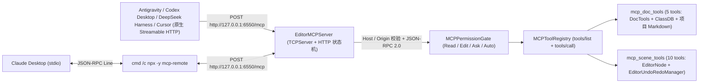

# Phase 1 实施计划：Godot 纯内置 HTTP MCP 服务底座与桌面端一键接入（方案 3，已同步更新）

> [!NOTE]
> 本计划对应 Phase 1 全部功能已完成落地并分两次本地提交至 `master`（`4a10783578`、`07907dc588`），[modules/editor_assistant/](../../modules/editor_assistant) 共 19 个新增文件，引擎原有已跟踪源码未作改动。

## 目标概述 (Goal Description)

对照定稿架构文档 [editor_assistant_architecture.md](./editor_assistant_architecture.md)，Phase 1 采用**纯内置 HTTP MCP 服务方案（方案 3，对标 UE 5.9 `Unreal MCP`）**：

1. **引擎原有源码零侵入**：不触碰 `main/main.cpp`、不接管主程序 `stdio`、不额外编译 `proxy.exe`。全部代码隔离在 [modules/editor_assistant/](../../modules/editor_assistant) 内，且仅在 `env.editor_build` / `TOOLS_ENABLED` 下编译，导出游戏模板编译跳过该模块。
2. **纯内置 Streamable HTTP MCP 服务 (`EditorMCPServer`)**：编辑器启动后默认在本地 `127.0.0.1:6550`（支持端口占用自动顺延 `6550..6560`）监听 `/mcp`（兼容 `/mcp/`）、`/` 与 `/health`；命令行通过 `OS::get_singleton()->get_cmdline_user_args()`（[os.h](../../core/os/os.h#L247)）解析 `-- --mcp-port <port>` 与 `-- --mcp-export=<target>`。
3. **两大核心基础工具集（共 15 个工具）**：
   * `doc_*`（5 个双源知识库工具）：直连 `EditorHelp::get_doc_data()`（`DocTools`）与 `ClassDB` 实时查询 Godot 4.8 API 签名与废弃状态；同时支持安全检索和读取当前项目 `res://` 下的本地 Markdown / 文本文档（`.md` / `.txt`）。
   * `scene_*`（10 个场景树工具）：直连 `EditorNode::get_edited_scene()` 内存态场景树，写操作经由 `EditorUndoRedoManager` 提交，支持节点增删重排、强类型属性读写、信号连接、资源编辑与无弹窗保存，支持 `Ctrl+Z` 撤回。
4. **多客户端一键配置导出 (`MCPConfigExporter`) 与直显式交互入口**：
   * **本机主力桌面客户端（原生 Streamable HTTP 直连）**：一键无损写入 **Antigravity**（`~/.gemini/config/mcp_config.json`）、**Codex 桌面版 / CLI**（`~/.codex/config.toml`）、**DeepSeek Harness**（`~/.dsh/cordis.patch.yml`）以及 Cursor（`.cursor/mcp.json`）。
   * **仅认 `stdio` 的旧客户端**：为 Claude Desktop 生成 `mcp-remote` 桥接配置（Windows 自动生成 `cmd /c npx -y mcp-remote`），不锁主编辑器 `.exe`。
   * **编辑器直接入口**：顶部工具栏右侧直接挂载 **`MCP :<port>`** 状态 `MenuButton`（`CONTAINER_TOOLBAR`），保留 **`项目 -> 工具 -> AI Assistant (MCP)`** 子菜单，并通过 `print_line()` 将启动日志稳定输出到**输出（Output）**面板与 `.console.exe`。

---

## 关键设计决策

1. **MCP 工具名采用下划线前缀（`doc_*` / `scene_*`）**：
   匹配主流 LLM 与客户端正则要求 `^[a-zA-Z0-9_-]{1,64}$`（禁止 `.`），统一使用下划线（如 `doc_search_classes`、`scene_add_node`）。
2. **日志可见性与顶部工具栏入口**：
   * 用户关闭 `EditorLog::MSG_TYPE_EDITOR`（`_editor_log_filter_4 = false`）时，直接使用 `MSG_TYPE_EDITOR` 会被输出面板过滤；因此 `_log_info()` 改为 `print_line(p_msg)`，由 `EditorNode::_print_handler` 路由为 `MSG_TYPE_STD` 并在 `.console.exe` 同步可见。
   * 仅藏在 `Project -> Tools -> AI Assistant (MCP)` 3 级子菜单时缺少界面提示；通过 `add_control_to_container(CONTAINER_TOOLBAR, toolbar_menu_button)`（置位于 `right_menu_spacer` 之前避免被窗口控制按钮遮挡）挂载扁平 `MenuButton`，附带 `StatusSuccess` / `StatusWarning` 图标、端口状态与一键导出下拉菜单。
3. **三端差异化无损合并策略**：
   * **Antigravity**：合并 JSON 对象 `mcpServers["godot-editor"]`，剥离前导 BOM 后写回；
   * **Codex 桌面版 / CLI**：带引号与多行方括号深度状态机的 TOML 分节合并器，妥善处理以 `\` 结尾的 Windows 单引号字面量路径（如 `'\\?\C:\Users\...'`）与多行 `args = [...]`，幂等替换 `[mcp_servers."godot-editor"]` 及子表；
   * **DeepSeek Harness (`dsh`)**：Cordis 顶层序列合并器，识别 `# 注释 + []` 空配置、拆解 `- insert:` 同级兄弟插件（如已有 `mcp-godot-ai`）并幂等替换为无 UTF-8 BOM 的 `id: mcp-godot-editor`（`transport: streamable-http`）。

---

## 模块架构与数据流



---

## 文件清单 (`modules/editor_assistant/`，共 19 个文件)

### 组件 1：模块编译配置与插件生命周期
* [config.py](../../modules/editor_assistant/config.py)：仅在 `env.editor_build` 启用；声明依赖 `jsonrpc`。
* [SCsub](../../modules/editor_assistant/SCsub)：在 `env.editor_build` 下编译 `*.cpp`、`mcp/*.cpp`、`mcp/tools/*.cpp`，当 `env["tests"]` 为真时编译 `tests/*.cpp`。
* [register_types.h](../../modules/editor_assistant/register_types.h) / [register_types.cpp](../../modules/editor_assistant/register_types.cpp)：`MODULE_INITIALIZATION_LEVEL_EDITOR` 阶段注册 `EditorAssistantPlugin`。
* [editor_assistant_plugin.h](../../modules/editor_assistant/editor_assistant_plugin.h) / [editor_assistant_plugin.cpp](../../modules/editor_assistant/editor_assistant_plugin.cpp)：
  * `EditorSettings`：`network/editor_assistant/mcp_enabled`、`mcp_host`（`"127.0.0.1"`）、`mcp_port`（`6550`）、`auto_fallback_port`（`true`）；
  * 命令行用户参数：`-- --mcp-port <port>` 与 `-- --mcp-export=<antigravity|codex|deepseek-harness|dsh|cursor|claude-desktop>`；
  * 菜单与工具栏按钮操作：
    1. `Configure Antigravity (~/.gemini/config/mcp_config.json)`
    2. `Configure Codex Desktop (~/.codex/config.toml)`
    3. `Configure DeepSeek Harness (~/.dsh/cordis.patch.yml)`
    4. `Configure Cursor (.cursor/mcp.json)`
    5. `Configure Claude Desktop`
    6. `Copy MCP Config JSON`
    7. `Copy MCP Endpoint URL`
    8. `Restart MCP Server`

### 组件 2：纯 HTTP MCP 服务端、权限网关与配置导出器 (`modules/editor_assistant/mcp/`)
* [mcp_permission_gate.h](../../modules/editor_assistant/mcp/mcp_permission_gate.h) / [mcp_permission_gate.cpp](../../modules/editor_assistant/mcp/mcp_permission_gate.cpp)：四级权限枚举（`Read` / `Edit` / `Ask` / `Auto`），Phase 1 默认策略 `Edit`。
* [mcp_tool_registry.h](../../modules/editor_assistant/mcp/mcp_tool_registry.h) / [mcp_tool_registry.cpp](../../modules/editor_assistant/mcp/mcp_tool_registry.cpp)：Schema 注册、权限检查与 MCP `CallToolResult` 封装。
* [mcp_server.h](../../modules/editor_assistant/mcp/mcp_server.h) / [mcp_server.cpp](../../modules/editor_assistant/mcp/mcp_server.cpp)：
  * 非阻塞 `TCPServer` HTTP/1.1 状态机（支持 `Content-Length` 与 chunked 请求体及超时清理）；
  * 回环 `Host` / `Origin` 防 DNS Rebinding 校验；
  * `GET /health`、`GET /mcp`（`405`）、`DELETE /mcp`（`200`）、`POST /mcp` / `/mcp/` / `/`；
  * `initialize` 协商兼容 `2024-11-05`、`2025-03-26`、`2025-06-18`、`2025-11-25`；`notifications/initialized` 返回 `202` 无响应体；`ping` 与 `tools/list` 支持省略 `params`。
* [mcp_config_exporter.h](../../modules/editor_assistant/mcp/mcp_config_exporter.h) / [mcp_config_exporter.cpp](../../modules/editor_assistant/mcp/mcp_config_exporter.cpp)：实现 Antigravity（`~/.gemini/config/mcp_config.json`）、Codex（`%CODEX_HOME%/config.toml` 或 `~/.codex/config.toml`）、DeepSeek Harness（`%DSH_HOME%/cordis.patch.yml` 或 `~/.dsh/cordis.patch.yml`）、Cursor、Claude Desktop 无损合并与剪贴板 JSON 生成。

### 组件 3：核心引擎工具组 (`modules/editor_assistant/mcp/tools/`)
* [mcp_doc_tools.h](../../modules/editor_assistant/mcp/tools/mcp_doc_tools.h) / [mcp_doc_tools.cpp](../../modules/editor_assistant/mcp/tools/mcp_doc_tools.cpp)（5 个只读工具）：`doc_search_classes`、`doc_get_class_detail`、`doc_check_api`、`doc_search_project_docs`、`doc_read_project_doc`。
* [mcp_scene_tools.h](../../modules/editor_assistant/mcp/tools/mcp_scene_tools.h) / [mcp_scene_tools.cpp](../../modules/editor_assistant/mcp/tools/mcp_scene_tools.cpp)（10 个场景与资源工具）：`scene_get_tree`、`scene_create_root`、`scene_add_node`、`scene_remove_node`、`scene_reparent_node`、`scene_get_properties`、`scene_set_property`、`scene_connect_signal`、`scene_edit_resource`、`scene_save`。

### 组件 4：C++ 单元测试 (`modules/editor_assistant/tests/`)
* [test_editor_assistant_mcp.h](../../modules/editor_assistant/tests/test_editor_assistant_mcp.h)：覆盖回环校验、JSON-RPC 生命周期、`doc_*` 沙箱与 `ClassDB` 检查、`JSON <-> Variant` 转换，以及 JSON / Codex TOML / DeepSeek Harness YAML 无损合并测试。

---

## 验证方案与脚本

1. **增量编译编辑器**：
   ```powershell
   $env:CLICOLOR_FORCE = '1'; .\.venv\Scripts\scons.exe platform=windows target=editor arch=x86_64 use_llvm=yes production=yes lto=thin d3d12=yes angle=no no_editor_splash=yes debug_symbols=no
   ```
2. **MCP 服务核心与工具端到端回归**（`verify_phase1_mcp.ps1`）：校验 `/health`、`405`、`403`、`initialize`/`202`/`tools/list`、`doc_*` 与 `scene_*` 全流程落盘测试场景 `world.tscn`。
3. **三端配置导出隔离验证**（`verify_client_exporters.ps1`）：在隔离 `USERPROFILE` / `CODEX_HOME` / `DSH_HOME` 中通过 `--mcp-export` 实测生成与端口幂等升级（`16550 -> 16551`），并用 PowerShell `ConvertFrom-Json`、Python `tomllib`、本机 `codex.exe mcp get/list` 以及 YAML UTF-8 无 BOM 检查校验落盘配置。
